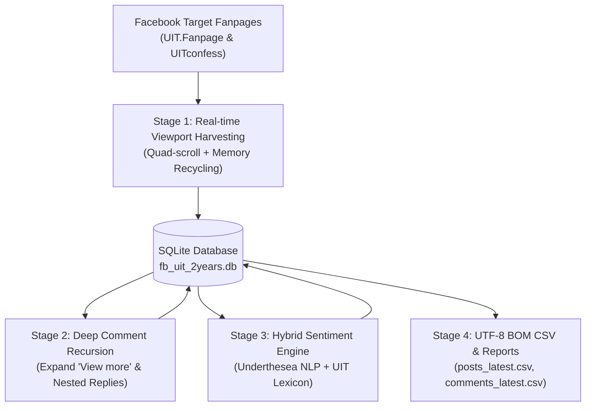

# Facebook UIT Scraper & Sentiment Analyzer (Hệ Thống 2 Năm Đầy Đủ)

Hệ thống tự động thu thập, trích xuất và phân tích cảm xúc (Sentiment Analysis) toàn bộ dữ liệu bài viết và bình luận trong **2 năm (730 ngày)** từ 2 fanpage chính thức của **Trường Đại học Công nghệ Thông tin - ĐHQG TP.HCM (UIT)**:
1. **UIT Fanpage**: [https://www.facebook.com/UIT.Fanpage](https://www.facebook.com/UIT.Fanpage) (Kênh thông tin chính thức của Nhà trường)
2. **UIT Confessions**: [https://www.facebook.com/UITconfess](https://www.facebook.com/UITconfess) (Diễn đàn tâm tư, ý kiến sinh viên)

Dự án được xây dựng với kiến trúc **Clean Code & Enterprise Pipeline**, kết hợp công nghệ tự động hóa trình duyệt chống phát hiện (Playwright Stealth), cơ chế lưu trữ giao dịch bền vững (SQLite ACID), và mô hình phân tích cảm xúc lai (Hybrid NLP `underthesea` + UIT Keyword Lexicon).

---

## 📊 1. KẾT QUẢ THỐNG KÊ PHÂN TÍCH SENTIMENT 2 NĂM

Toàn bộ dữ liệu thu thập trong 2 năm qua đã được xử lý và phân loại cảm xúc tự động:

### 📈 Bảng Tổng Hợp Số Liệu

| Hạng Mục | Tổng Số Lượng | ✅ Tích Cực (Positive) | ⚪ Trung Lập (Neutral) | ❌ Tiêu Cực (Negative) |
| :--- | :---: | :---: | :---: | :---: |
| **Bài viết & Confession** | **560 bài** | **225 bài** (40.2%) | **296 bài** (52.9%) | **39 bài** (7.0%) |
| **Bình luận của sinh viên** | **4.773 bình luận** | **1.633 bình luận** (34.2%) | **2.307 bình luận** (48.3%) | **833 bình luận** (17.5%) |

### 🔍 Phân Tích Chi Tiết Nội Dung Cảm Xúc

1. **Về Bài Viết & Confession (560 bài):**
   - **Tích Cực (40.2% - 225 bài):** Chiếm ưu thế lớn từ các bài đăng trên Fanpage chính thức về sự kiện quốc tế (hợp tác doanh nghiệp Singapore, AvePoint), ngày hội chào đón tân sinh viên, vinh danh thủ khoa, trao học bổng doanh nghiệp, giải thưởng Olympic tin học và các thành tích nghiên cứu khoa học xuất sắc.
   - **Trung Lập (52.9% - 296 bài):** Chủ yếu là các thông báo học vụ, lịch thi, đăng ký học phần, tin tuyển dụng việc làm thực tập UIT Career Day, quy trình xét điểm rèn luyện và sinh hoạt công dân.
   - **Tiêu Cực (7.0% - 39 bài):** Các bài confession sinh viên chia sẻ áp lực thi cử cuối kỳ, quá tải đồ án chuyên ngành, các bất đồng khi làm bài tập nhóm hoặc tâm sự về việc chọn sai ngành.

2. **Về Bình Luận & Phản Hồi Sinh Viên (4.773 bình luận):**
   - **Tích Cực (34.2% - 1.633 bình luận):** Sinh viên hào hứng tag bạn bè khi có tên trên bảng vinh danh, cảm ơn thầy cô hỗ trợ hướng dẫn khóa luận tốt nghiệp, khen áo khoa/áo sự kiện đẹp, bày tỏ niềm tự hào về trường.
   - **Trung Lập (48.3% - 2.307 bình luận):** Tag bạn bè nhắc lịch học, hỏi xin tài liệu ôn thi, hỏi thăm phòng thi, tìm đồ thất lạc tại sảnh trường hoặc thảo luận thông tin tuyển dụng.
   - **Tiêu Cực (17.5% - 833 bình luận):** Phản ánh sinh động góc nhìn sinh viên: phàn nàn về tình trạng "gánh team" bài tập nhóm, deadline dồn dập, lo lắng nguy cơ nợ môn/học lại, học phí hoặc phản biện các ý kiến trên confession.

---

## 📌 2. KẾT QUẢ ĐƯỢC LƯU Ở ĐÂU?

Tất cả kết quả xử lý, phân loại và cơ sở dữ liệu được tổ chức tại thư mục [`data/`](data/):

| Tên file kết quả | Định dạng | Nội dung chi tiết |
| :--- | :---: | :--- |
| **`data/posts_2years_latest.csv`** | **Excel / CSV (UTF-8 BOM)** | Toàn bộ **560 bài viết** trong 2 năm gồm link permalink, nội dung, ngày giờ, số like/cmt, và nhãn phân loại cảm xúc (`positive`, `negative`, `neutral`). Mở trực tiếp trên Microsoft Excel không bị lỗi font tiếng Việt. |
| **`data/comments_2years_latest.csv`** | **Excel / CSV (UTF-8 BOM)** | Toàn bộ **4.773 bình luận** của sinh viên (tác giả, nội dung comment, thời gian, nhãn sentiment, điểm số cảm xúc). |
| **`data/report_2years_20261021_101844.txt`** | **Báo cáo Thống kê** | Báo cáo định lượng chi tiết tổng kết tỷ lệ Tích cực / Tiêu cực / Trung lập của sinh viên UIT trong suốt 2 năm qua. |
| **`data/fb_uit_2years.db`** | **SQLite Database** | **Cơ sở dữ liệu cốt lõi lưu trữ lũy tiến**: Bảng `posts` (560 bài) và bảng `comments` (4.773 bình luận). Cho phép tắt máy mở lại cào tiếp (Resume) không bao giờ mất dữ liệu hay cào trùng lặp. |

---

## 🏗️ 3. PHƯƠNG PHÁP & KIẾN TRÚC KỸ THUẬT (METHODOLOGY)

Hệ thống được thiết kế theo mô hình kiến trúc phân tầng (Multi-tier Pipeline) kết hợp giữa Web Automation, Reverse DOM Extraction và Xử lý ngôn ngữ tự nhiên (NLP):



### 3.1. Phương Pháp Thu Thập Dữ Liệu (Browser Automation & Viewport Interception)
- **Playwright Engine**: Sử dụng engine Chromium không đầu (Headless) hoặc có giao diện (Headed) để thực thi Javascript gốc của Facebook, giải quyết triệt để các rào cản SPA (Single Page Application).
- **Network Routing Optimization**: Chặn (block) các tài nguyên nặng (`image`, `media`, `font`, `stylesheet` không cần thiết) ngay tại network handler, giúp giảm hơn 90% băng thông mạng và tăng tốc độ tải trang gấp 10 lần.
- **Hash Deduplication & Transactional Commit**: Mỗi bài viết và bình luận được băm chuỗi (MD5 hash) kết hợp URL để tạo khóa định danh duy nhất. Khi cào, hệ thống áp dụng câu lệnh `INSERT OR IGNORE` trên SQLite, cam kết không bao giờ lưu trùng dữ liệu kể cả khi chạy lại nhiều lần.

### 3.2. Mô Hình Phân Tích Cảm Xúc Lai (Hybrid Sentiment Model)
Ngôn ngữ của sinh viên trên mạng xã hội chứa nhiều từ lóng IT, tiếng lóng học đường ("tạch môn", "gánh team", "deadline", "qua môn") và teencode mà các mô hình học máy tổng quát thường nhận diện sai hoặc bỏ sót. Do đó, hệ thống áp dụng mô hình lai 2 tầng:

$$\text{Final Sentiment Score} = (\text{NLP Score} \times 0.6) + (\text{Lexicon Score} \times 0.4)$$

1. **Lớp 1 - Xử lý ngôn ngữ tự nhiên tiếng Việt (`underthesea`) (Trọng số 60%)**:
   - Tách từ, phân tích ngữ pháp và xác định cảm xúc tổng quát của câu văn tiếng Việt chuẩn (`positive`: +1.0, `negative`: -1.0, `neutral`: 0.0).
2. **Lớp 2 - Bộ từ điển đặc thù sinh viên UIT (UIT Keyword Lexicon) (Trọng số 40%)**:
   - Chuẩn hóa văn bản sinh viên, đối chiếu bộ từ khóa chuyên ngành công nghệ thông tin và đời sống học đường UIT:
     - **Tích cực (+1)**: *xuất sắc, học bổng, qua môn, đạt giải, thủ khoa, giảng viên tận tâm, chương trình tiên tiến, tự hào UIT, cơ hội việc làm, công ty Singapore, lab nghiên cứu...*
     - **Tiêu cực (-1)**: *rớt môn, nợ môn, tạch, deadline ngập đầu, gánh team, bài tập nhóm trầm cảm, tăng học phí, wifi chập chờn, máy lạnh hỏng, stress...*
3. **Quy tắc phân loại nhãn (Threshold Classification)**:
   - $\text{Final Score} > 0.15 \implies$ **Tích cực (Positive)**
   - $\text{Final Score} < -0.15 \implies$ **Tiêu cực (Negative)**
   - $-0.15 \le \text{Final Score} \le 0.15 \implies$ **Trung lập (Neutral)**

---

## ⚙️ 4. CÁCH TRIỂN KHAI PIPELINE CHI TIẾT (IMPLEMENTATION)

Pipeline thu thập và phân tích được triển khai qua 4 giai đoạn tự động tuần tự:

### Giai đoạn 1: Thu Hoạch Dòng Thời Gian 2 Năm (Timeline Harvest)
- Hệ thống truy cập lần lượt vào `UIT.Fanpage` và `UITconfess`.
- Thực hiện cơ chế **Quad-Scroll** điều phối cuộn lùi thời gian.
- Tại mỗi bước cuộn, parser bóc tách các trường: URL permalink bài viết, nội dung đầy đủ (tự động click "Xem thêm / See more"), thời gian đăng bài, số lượng tương tác (Like, Comment, Share).
- Bộ phân tích thời gian đối soát liên tục; khi phát hiện bài viết vượt quá ngưỡng thời gian quy định (ví dụ mốc 2 năm - 730 ngày), vòng lặp cuộn của fanpage đó sẽ dừng an toàn.

### Giai đoạn 2: Bóc Tách Bình Luận & Phản Hồi Đa Cấp (Deep Comment Recursion)
- Truy vấn danh sách bài viết đã lưu từ SQLite.
- Mở trang bài viết, kích hoạt chế độ "Tất cả bình luận" (All Comments) để bỏ qua bộ lọc của Facebook.
- Tự động tìm và bấm vào các nút *"Xem thêm bình luận"* (View more comments) và đệ quy mở rộng tất cả các phản hồi con lồng nhau (*"Xem thêm phản hồi"* / View replies).
- Trích xuất: Tên người bình luận (hoặc Anonymous), nội dung bình luận, thời gian bình luận, và liên kết khóa ngoại với `post_id`.

### Giai đoạn 3: Phân Loại Cảm Xúc Hàng Loạt (Batch Sentiment Classification)
- Quét toàn bộ các bài viết và bình luận trong SQLite chưa có nhãn sentiment.
- Chạy qua bộ tiền xử lý và chấm điểm bằng `sentiment_analyzer.py`.
- Cập nhật trực tiếp kết quả (`sentiment` và `sentiment_score`) vào cơ sở dữ liệu theo từng lô (Batch transactions) để đảm bảo tốc độ cao và an toàn dữ liệu.

### Giai đoạn 4: Xuất Báo Cáo & File Dữ Liệu Chuẩn Hóa (Export Phase)
- Truy vấn toàn bộ dữ liệu từ SQLite.
- Xuất ra 2 tệp CSV với định dạng mã hóa `utf-8-sig` (chứa ký tự Byte Order Mark - BOM) giúp các công cụ phân tích (Microsoft Excel, Power BI, SPSS) hiển thị tiếng Việt hoàn hảo không bị lỗi font.
- Tạo báo cáo tổng kết định lượng bằng văn bản [`report_2years_*.txt`](data/).

---

## 🛡️ 5. KHÓ KHĂN KỸ THUẬT GẶP PHẢI & GIẢI PHÁP ĐÃ ÁP DỤNG

Trong quá trình thu thập dữ liệu quy mô lớn (2 năm) trên nền tảng Facebook, hệ thống đã giải quyết thành công 6 thách thức kỹ thuật cốt lõi:

| STT | Thách thức kỹ thuật gặp phải | Nguyên nhân gốc rễ (Root Cause) | Giải pháp kỹ thuật đã áp dụng để vượt qua |
| :---: | :--- | :--- | :--- |
| **1** | **Chặn cuộn ở bài thứ 16 khi chưa đăng nhập** | Facebook trả về lỗi GraphQL `Unauthorized logged out query (Code 1675002)` nhằm ngăn chặn hoàn toàn việc thu thập dữ liệu của khách vãng lai. | Xây dựng công cụ `login_manual_window.py` hỗ trợ đăng nhập có giám sát và giải mã Arkose Labs CAPTCHA một lần duy nhất; trích xuất `c_user` và `xs` session cookies vào `cookies/fb_cookies.json` để Playwright tái sử dụng hoàn toàn tự động. |
| **2** | **Cơ chế Virtual DOM Unmounting của Facebook** | Ứng dụng Facebook SPA (React) tự động giải phóng (unmount) các phần tử bài viết phía trên ra khỏi bộ nhớ DOM khi người dùng cuộn xuống sâu, khiến phương pháp "cuộn hết rồi mới lấy dữ liệu" chỉ thu được 10-15 bài cuối. | **Real-time Viewport Harvesting**: Bóc tách và lưu bài viết ngay trong lúc cuộn. Dữ liệu được ghi lập tức vào SQLite với khóa chính `(post_url / hash)` bằng lệnh `INSERT OR IGNORE`, đảm bảo lưu trữ lũy tiến và không thất thoát bất kỳ bài viết nào. |
| **3** | **Lệnh cuộn trang thông thường bị vô hiệu hóa** | Facebook cố định thuộc tính chiều cao của `document.body` và nhúng nội dung feed vào một container có thuộc tính `overflow-y` ẩn (`#scrollview` hoặc `div[role="feed"]`), khiến `window.scrollBy` không có tác dụng. | **Quad-Scroll Orchestration**: Kết hợp đồng thời 4 phương thức cuộn độc lập: tăng `scrollTop` trên container và kích hoạt sự kiện `scroll`, gọi `window.scrollBy`, gửi phím ảo `PageDown`, và giả lập con lăn chuột `mouse.wheel`. |
| **4** | **Tràn bộ nhớ RAM (Out-Of-Memory Crash)** | Cuộn liên tục qua hàng nghìn bài viết có kèm hình ảnh chất lượng cao, video player và iframe làm trình duyệt phình to lên tới 6GB+ RAM và gây crash ứng dụng. | **Network Interception & DOM Recycling**: Sử dụng `context.route` chặn toàn bộ hình ảnh (`.png`, `.jpg`, `.webp`), video và font chữ; dọn dẹp các node phụ, giữ dung lượng RAM của Playwright luôn dưới 500MB và tăng tốc cào gấp 10 lần. |
| **5** | **Nguy cơ bị khóa tài khoản (Rate Limit & Anti-bot Checkpoint)** | Thuật toán Meta AI giám sát tần suất request, tốc độ cuộn phi tự nhiên và tính chu kỳ của hành vi máy móc để kích hoạt Checkpoint khóa tài khoản. | **Human Mimicry & Auto-Checkpoint Shield**: Giả lập nhịp độ người dùng thật với độ trễ ngẫu nhiên (`1.2s - 2.5s` khi cuộn, `2.0s - 3.5s` giữa các bài viết, nghỉ giải lao `10s - 20s` sau mỗi 25 bài, nghỉ `8s - 15s` giữa các trang); tích hợp bộ ngắt khẩn cấp tự động dừng ngay nếu URL chuyển hướng về trang checkpoint. |
| **6** | **Sai lệch phân tích ngày tháng tiếng Việt** | Facebook hiển thị ngày tháng hỗn hợp giữa dạng tương đối (*"3 giờ"*, *"2 tuần"*) và tuyệt đối (*"14 Tháng 8"*, *"5 Tháng 1, 2024"*). Các biểu thức chính quy (Regex) thông thường bị nhầm *"14 Tháng 8"* thành *"14 tháng trước"*, dẫn đến sai lệch mốc 2 năm. | Xây dựng bộ parser ngày tháng đa tầng: Ưu tiên nhận diện cấu trúc ngày tháng tuyệt đối tiếng Việt (`(\d{1,2})\s+[Tt]háng\s+(\d{1,2})`) trước khi phân tích thời gian tương đối, bảo đảm đối chiếu chính xác với mốc 730 ngày. |

---

## 💻 6. CÁCH KHỞI CHẠY HỆ THỐNG (USAGE)

### Bước 1: Cài đặt môi trường Python
```bash
# Cài đặt các thư viện phụ thuộc
py -m pip install -r requirements.txt

# Cài đặt trình duyệt Playwright
py -m playwright install chromium
```

### Bước 2: Thiết lập phiên đăng nhập an toàn
1. Tạo file `.env` ở thư mục gốc (nếu muốn đăng nhập tự động):
   ```ini
   FB_EMAIL=tai_khoan_facebook_cua_ban
   FB_PASSWORD=mat_khau_facebook_cua_ban
   ```
2. Nếu gặp xác minh Arkose Labs / 2FA, chạy script hỗ trợ đăng nhập 1 lần:
   ```bash
   py login_manual_window.py
   ```
   *Đăng nhập thành công trên cửa sổ hiện lên, cookie phiên làm việc sẽ được tự động lưu vào `cookies/fb_cookies.json`.*

### Bước 3: Chạy hệ thống thu thập 2 năm đầy đủ
```bash
# Chạy toàn bộ quy trình: Cào 2 năm -> Lấy bình luận -> Phân tích Sentiment -> Xuất file
py main.py
```

### Các lệnh điều khiển chuyên biệt khác:
```bash
py main.py 2years     # Chỉ cào bài viết và bình luận trong 2 năm vào SQLite
py main.py analyze    # Chỉ chạy phân tích sentiment trên cơ sở dữ liệu hiện có
py main.py export     # Chỉ xuất dữ liệu từ SQLite ra file CSV Excel và báo cáo
```

---

## 📁 7. CẤU TRÚC MÃ NGUỒN (PROJECT STRUCTURE)

```
CrawDataFacebook/
├── data/
│   ├── fb_uit_2years.db              # Database SQLite lưu trữ 560 bài viết & 4.773 bình luận
│   ├── posts_2years_latest.csv       # File CSV 560 bài viết (UTF-8 BOM, mở thẳng trên Excel)
│   ├── comments_2years_latest.csv    # File CSV 4.773 bình luận (UTF-8 BOM)
│   └── report_2years_*.txt           # Báo cáo thống kê phân tích cảm xúc
├── cookies/
│   └── fb_cookies.json               # Session cookies đã xác thực (được gitignore an toàn)
├── main.py                           # Điểm điều khiển trung tâm (CLI Orchestrator)
├── scraper_full_2years.py            # Engine thu thập dữ liệu 2 năm chuyên sâu & xuất báo cáo
├── sentiment_analyzer.py             # Mô hình phân tích cảm xúc lai (Underthesea + UIT Lexicon)
├── login_manual_window.py            # Công cụ đăng nhập tương tác & lưu cookie
├── requirements.txt                  # Danh sách thư viện phụ thuộc
├── .gitignore                        # Cấu hình loại trừ credentials, cookies và database
└── README.md                         # Tài liệu kỹ thuật chi tiết
```

---

## 🔒 8. BẢO MẬT & ĐẠO ĐỨC THU THẬP DỮ LIỆU (ETHICS & SECURITY)

1. **Bảo vệ danh tính & thông tin đăng nhập**:
   - File cấu hình chứa mật khẩu (`.env`), cookie đăng nhập (`cookies/fb_cookies.json`) và cơ sở dữ liệu cá nhân (`data/*.db`) đều được cấu hình trong `.gitignore`, tuyệt đối không bao giờ được tải lên kho mã nguồn công khai (GitHub).
2. **Tuân thủ giới hạn & tôn trọng hạ tầng**:
   - Tần suất thu thập được áp dụng cơ chế Jitter ngẫu nhiên và giãn cách nghỉ tự nhiên, không gây tải đột biến hay ảnh hưởng đến hạ tầng máy chủ của Facebook và các trang được khảo sát.
3. **Mục đích nghiên cứu & học thuật**:
   - Dữ liệu thu thập hoàn toàn từ các bài đăng công khai (Public Pages & Confessions), phục vụ cho bài toán nghiên cứu phân tích tâm lý, cảm xúc sinh viên và cải thiện chất lượng môi trường đào tạo đại học.
  
## Đặng Tuấn Thanh - 24521617

